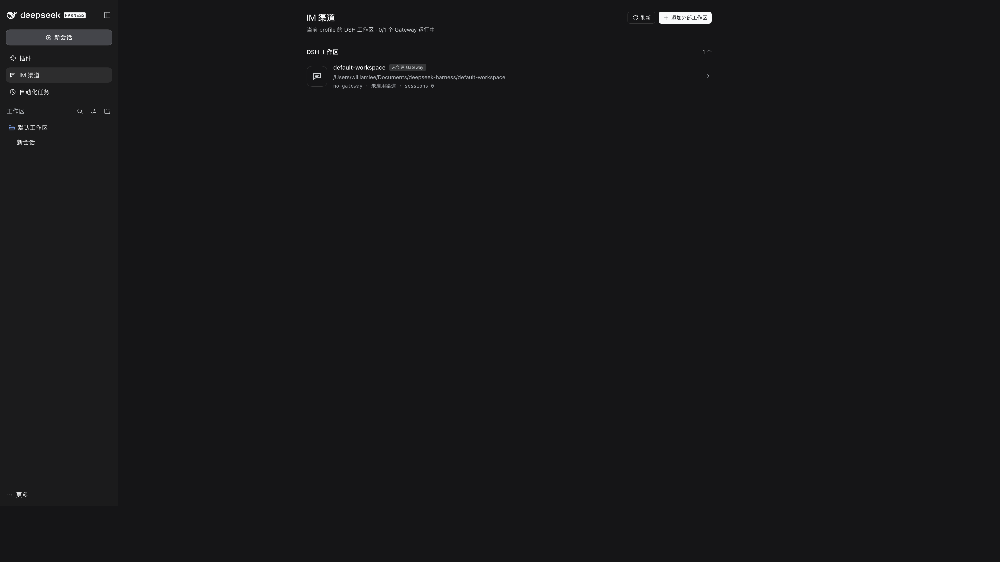
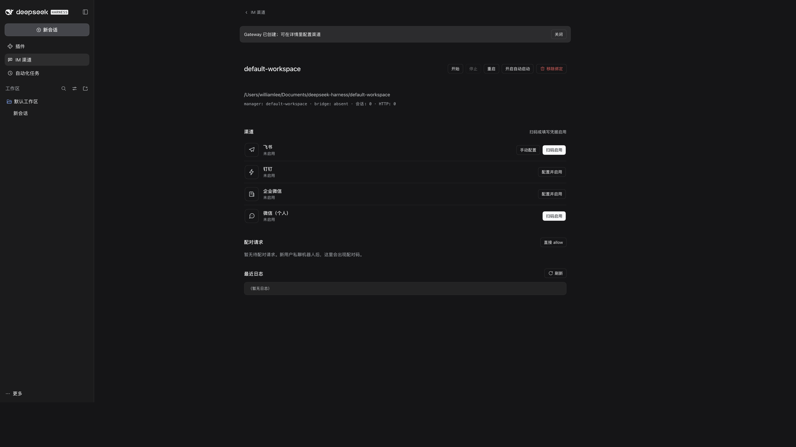

# dsh-im-manager

[](https://github.com/iswilliamleeya/dsh-im-manager/actions/workflows/ci.yml)
[](https://github.com/iswilliamleeya/dsh-im-manager/releases)
[](LICENSE)

**把飞书 / 钉钉 / 企业微信 / 个人微信接进 DeepSeek Harness。**
每条 IM 消息 → DSH Agent 一轮回答 → 按平台限制分片发回。

一个工作区 = 一个 Gateway = 一个独立 `dsh --profile sdk` runtime = 一套渠道账号；
多工作区在 DSH 宿主内并发，互不共享上下文。管理界面就是 DSH 左侧栏的 **「消息」**。



## 功能

- **四个渠道**：飞书、钉钉、企业微信、微信（个人，腾讯官方 iLink）
- **DSH 原生管理页**：左侧栏「消息」，列表/详情两级导航，风格对齐 DSH「插件」页
- **多工作区**：自动发现当前 profile 的所有 DSH 工作区，按需创建/启动 Gateway
- **扫码连接**：飞书 / 微信支持扫码；钉钉 / 企微填凭据保存即启用
- **会话同步**：IM session 自动出现在 DSH 侧栏并归入对应工作区
- **访问控制**：私聊 pairing、allowlist、群聊 @ 门禁
- **入站媒体**：图片/文件下载；图片可直接给视觉模型，文件落到工作区并给 Agent 路径
- **每个工作区独立**：独立配置、stateDir、HTTP 端口、DSH runtime、会话



## 架构

```text
IM 平台 ──adapter──▶ core（去重 / 访问控制 / 会话 / 编排）──bridge──▶ dsh --profile sdk
   ▲                                                                      │
   └──────────────────── 回复（文本分片）◀── turn/end ◀── assistant/message

DSH 宿主（desktop profile）
  └─ host plugin ─▶ manager ─┬─ workspace A：gateway → sdk runtime（飞书）
                             ├─ workspace B：gateway → sdk runtime（钉钉）
                             └─ workspace C：gateway → sdk runtime（微信）
```

- 宿主插件生命周期由 DSH 管理；DSH 退出/卸载插件时停止 manager 与全部 Gateway；
- manager 的本机 HTTP API（`127.0.0.1:8788`）只用于 attach/健康检查，**没有浏览器 Web UI**；
- 单实例锁 `~/.dsh-im-manager/manager.lock` 保证同一 profile 只有一个 owner；
- 每个工作区独立 spawn 自己的 SDK runtime，上下文隔离；不是 OS 进程隔离。

## 安装

要求：Node.js >= 22.19、可用的 DSH Desktop / Web。

```bash
# 从 GitHub 安装到 desktop profile（推荐）
dsh plugin --profile desktop add github:iswilliamleeya/dsh-im-manager

# 本地 checkout / release tarball
dsh plugin --profile desktop add /absolute/path/to/dsh-im-manager
dsh plugin --profile desktop add ./dsh-im-manager-0.2.1.tgz
```

- 包声明 `dsh.bundle`，安装后自动挂载 host 插件（manager 模式）和「消息」侧栏页面；
- 安装完成后在 DSH「插件 → 已安装插件」可见，可启停/卸载；
- 首次安装若 pnpm 提示 `protobufjs` 构建脚本被忽略（飞书 SDK 的传递依赖），
  按插件页提示允许构建并重试；
- 开发/离线安装：`bash install/activate.sh`（不经过 pnpm），`bash install/activate.sh --remove` 卸载。

安装/更新客户端半边后需要**重启 DSH**。

## 快速开始

1. 重启 DSH，打开左侧栏 **「消息」**；
2. 在「DSH 工作区」选择工作区 → **「创建 Gateway」**；
3. 在渠道行里扫码或填写凭据：
   - 飞书 / 微信：扫码启用（飞书也可手动填 App ID/Secret）；
   - 钉钉 / 企业微信：填配置保存即启用；
4. 需要随 DSH 自动恢复时打开 **「自动启动」**；
5. 用户私聊机器人后，在「配对请求」里批准配对码。

更多渠道配置：[飞书](docs/channels/feishu.md)、[钉钉](docs/channels/dingtalk.md)、
[企业微信](docs/channels/wecom.md)、[个人微信](docs/channels/weixin.md)。

## 工作区模型

- **一个工作区 = 一个 gateway = 一个 DSH runtime = 一套渠道账号**；
- 工作区内每个 IM 会话（渠道/账号/聊天/话题）各自一个 DSH session；
- 首次 IM 消息创建 session，后续消息沿用，`/new` 才轮换；
- 同一渠道账号不要跨工作区并发绑定（会抢长连接）；
- Gateway 创建时渠道默认全部关闭，需要显式启用。

数据位置：

| 内容 | 路径 |
| --- | --- |
| manager 列表 | `~/.dsh-im-manager/manager.json`（0600） |
| manager 锁 | `~/.dsh-im-manager/manager.lock` |
| 工作区配置 | `<workspace>/.dsh-im-manager/config.json` |
| 工作区状态/凭据 | `<managerDataDir>/workspaces/<id>/state` |
| 个人微信登录态 | `<stateDir>/channels/weixin/credentials.json`（0600） |

## 安全

- 私聊默认 **pairing**：陌生人只收到 6 位配对码，owner 批准后才可用；
- 群聊默认关闭；开启后默认要求 @ 机器人；
- manager HTTP API、工作区 HTTP 只监听 loopback，**无鉴权、无 TLS**，不要暴露公网；
- 密钥推荐 `env:VAR` 插值；页面/API/日志中的密钥显示为 `***`；
- 个人微信凭据等价于登录态，不要提交或外传；
- 配对批准 / allowlist 是特权操作，不在共享屏幕/录屏中操作。

## 诊断 CLI

运行入口只有 DSH profile bundle；CLI 是可选诊断工具：

```bash
dsh-im-manager doctor [--config PATH]      # 配置 / DSH / SDK profile / 端口 / 渠道字段
dsh-im-manager status [--config PATH]      # 读 stateDir/gateway.json 并检查 pid
dsh-im-manager channels [--config PATH]    # 已启用渠道
dsh-im-manager sessions [--config PATH]    # IM 会话 → DSH sessionId 映射
dsh-im-manager list [--config PATH]        # allowlist / 待配对
dsh-im-manager pair <code>                 # 批准配对码
dsh-im-manager allow <channel>:<senderId>  # 直接加白
dsh-im-manager revoke <channel>:<senderId> # 移出白名单
dsh-im-manager weixin login|status|logout  # 个人微信扫码登录 / 查看 / 退出
```

`serve` / `manager` / `init` 已移除；不要再通过独立进程或浏览器 8788 管理。

## 开发

```bash
npm install
npm test                 # 625 tests / 48 suites
npm pack                 # 生成 dsh-im-manager-<version>.tgz

bash install/verify-plugin.sh   # 隔离 DSH_HOME 验证 host plugin 加载/释放
```

项目结构：

- `src/adapters/`：飞书 / 钉钉 / 企微 / 微信渠道
- `src/core/`：去重、访问控制、会话绑定、回复分片
- `src/bridge/`：DSH SDK runtime 协议
- `src/manager/`：多工作区 manager + 本机 HTTP API
- `src/host/`：DSH 宿主插件、manager lock、RPC、workspace 发现/归组
- `lib/client.js`：DSH 侧栏「消息」客户端
- `src/cli.js`：诊断 CLI

## 文档

- [docs/architecture.md](docs/architecture.md)：分层、数据流、重启语义
- [docs/manager.md](docs/manager.md)：manager.json / HTTP API / 原生页面
- [docs/configuration.md](docs/configuration.md)：完整配置字段
- [docs/security.md](docs/security.md)：配对、白名单、群策略、密钥
- [docs/operations.md](docs/operations.md)：日志、升级、排障
- [docs/channels/index.md](docs/channels/index.md)：四渠道总览
- [docs/verification.md](docs/verification.md)：测试与验证记录
- [docs/manager-contract.md](docs/manager-contract.md)：manager/API 契约

## License

[MIT](LICENSE) © 2026 iswilliamleeya
